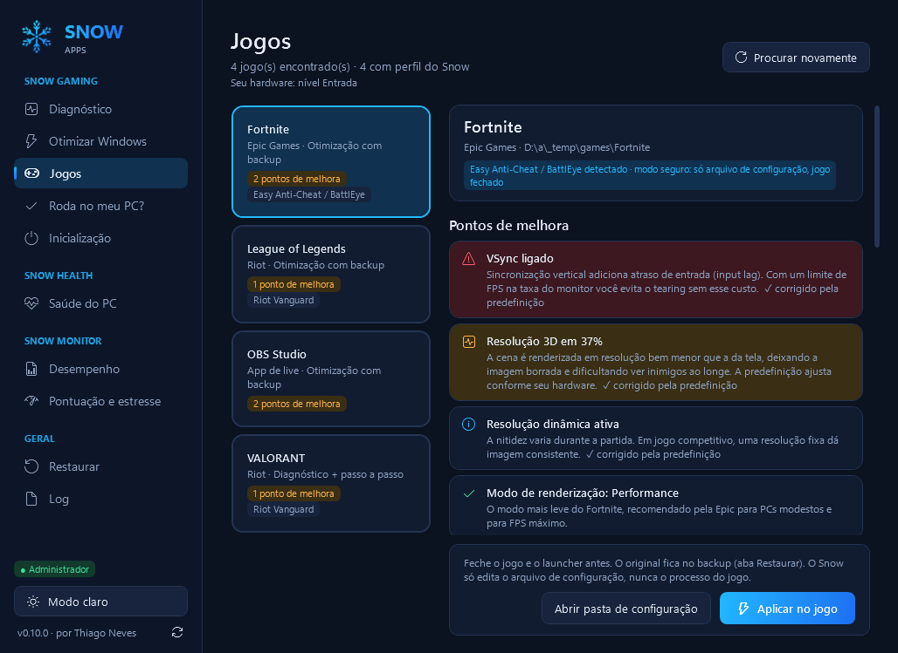
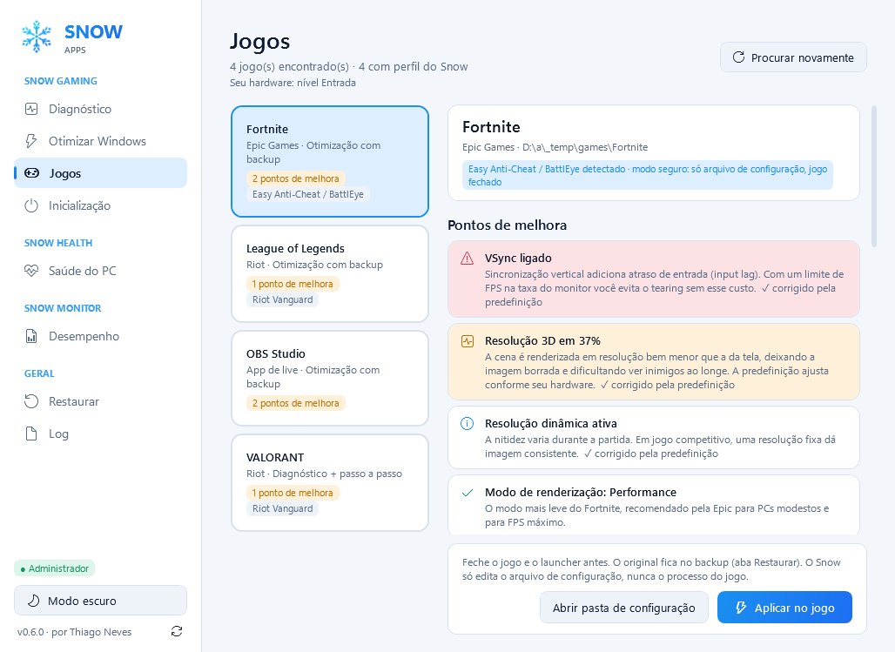
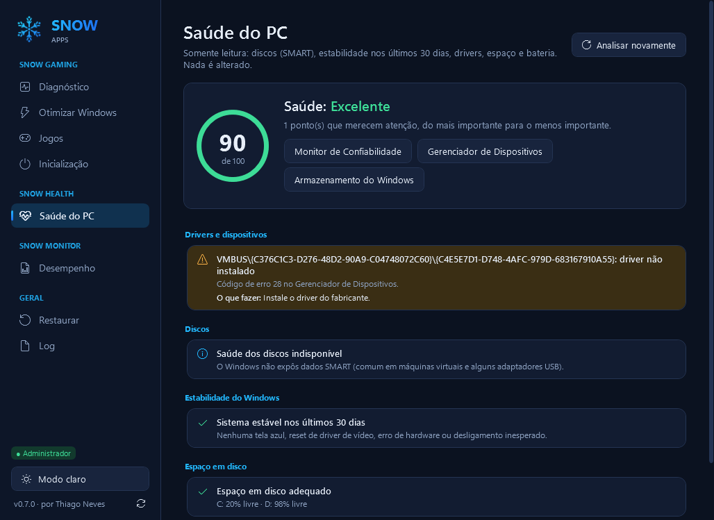
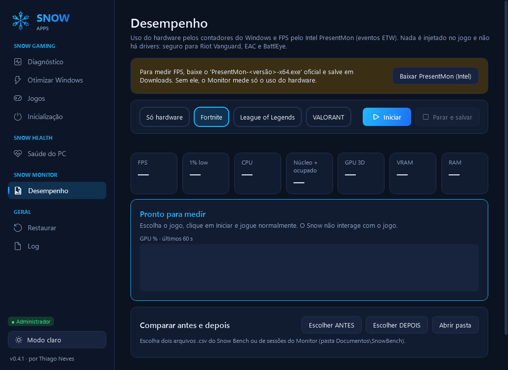

<p align="center">
  
</p>

<p align="center">
  <b>Snow Apps — um kit para o seu PC: <i>Snow Gaming</i> (otimização), <i>Snow Health</i> (saúde) e <i>Snow Monitor</i> (desempenho).</b><br>
  Diagnóstico de hardware e otimizações reais, seguras e reversíveis para jogos no Windows 10 e 11.<br>
  C# · .NET 8 · WPF · zero dependências externas · modo escuro

**Site:** https://acnaell.github.io/Snow-Apps/
</p>

---

## O que o Snow faz

1. **Diagnostica o PC**: CPU (incluindo Intel híbrida P/E-cores e Ryzen X3D), GPU (VRAM real, driver, suporte a HAGS), RAM (velocidade, canais, tipo), discos (NVMe, SATA SSD ou HDD, onde estão o Windows e os jogos) e o estado do Windows (plano de energia, Modo de Jogo, HAGS, otimizações de janela, Game DVR, HVCI, SysMain e telemetria).
2. **Recomenda um perfil** com base no hardware e explica o porquê.
3. **Mostra exatamente o que será alterado**: cada ajuste lista as chaves de registro, serviços e índices de energia que vai mudar, com uma nota honesta sobre o ganho real.
4. **Aplica com backup**: antes de cada mudança, o valor original é gravado (backup incremental em JSON e, opcionalmente, um ponto de restauração do Windows).
5. **Reverte tudo** com um clique, devolvendo exatamente os valores originais.

## Snow Gaming · Jogos
O Snow identifica os jogos instalados (**Steam**, **Epic Games** e **Riot**), mostra **pontos de melhora** de cada um e oferece duas predefinições ajustadas ao nível do seu hardware e à taxa do seu monitor:

- **FPS Médio**: qualidade e estabilidade.
- **FPS Alto**: competitivo, com menor latência.

| Jogo | Suporte | O que o Snow faz |
|---|---|---|
| Fortnite | Edita com backup | `GameUserSettings.ini`: modo Performance, resolução 3D, qualidades, VSync, limite de FPS = monitor, Reflex (NVIDIA) |
| League of Legends | Edita com backup | `game.cfg`: só as opções gráficas que o LoL mantém locais (as sincronizadas com a conta ficam de fora) + VSync |
| Valorant | Diagnóstico + passo a passo | Lê `RiotUserSettings.ini` (ex.: renderização multithread desligada) e orienta no menu; não edita porque as configurações são sincronizadas com a conta |
| OBS Studio (live) | Edita com backup | `basic.ini` do perfil ativo: codificador da placa de vídeo (AMD AMF / NVENC / Quick Sync) no lugar do x264, 6000 kbps, saída 720p60 ("jogo em primeiro lugar") ou 936p60 ("live mais nítida"). No modo Avançado, orienta o codificador passo a passo |
| Rocket League | Edita com backup | `TASystemSettings.ini`: VSync, desfoque, bloom, profundidade de campo, reflexos; FPS Alto também tira sombras dinâmicas. Só mexe em chaves que o jogo já gravou |
| Qualquer jogo Unreal Engine 4/5 | Diagnóstico | Acha o `GameUserSettings.ini` sozinho e aponta VSync, limite de FPS, resolução dinâmica e resolução 3D baixa |
| Outros jogos | Diagnóstico básico | Instalação em HDD, notebook com duas GPUs, jogo aberto |

Toda predefinição mostra uma prévia **"atual → novo"** com o motivo de cada opção, grava o valor original no backup e preserva o resto do arquivo byte a byte.

### Jogos com anti-cheat (Riot Vanguard, Easy Anti-Cheat, BattlEye)
O Snow foi desenhado para conviver com anti-cheats:
- **Nunca** abre, injeta, lê memória ou muda a prioridade do processo do jogo. Para saber se o jogo está aberto, só consulta o **nome** na lista de processos.
- **Não** cria regras por executável (IFEO, compatibilidade, afinidade).
- **Só** edita arquivos de configuração do usuário, e apenas com o jogo e o launcher **fechados**.
- **Nenhum** driver de kernel. O Vanguard bloqueia drivers vulneráveis como o WinRing0, usado por muitos monitores de temperatura.
- Jogos com configurações sincronizadas na conta (Valorant) ficam somente leitura.
- O Snow detecta o Vanguard pelo próprio arquivo de instalação da Riot (`vanguard: true`).

## Snow Health
Nota de saúde de 0 a 100, **somente leitura** e sem drivers. Ela cobre:
- **Discos**: saúde, desgaste do SSD, horas ligado, erros não corrigidos, temperatura e previsão de falha (SMART exposto pelo Windows).
- **Estabilidade** nos últimos 30 dias: telas azuis, resets do driver de vídeo (TDR), erros de hardware (WHEA), desligamentos inesperados e apps que travam.
- **Dispositivos** com erro e idade do driver de vídeo.
- **Espaço** em disco, **bateria** (desgaste e ciclos) e reinicialização pendente.

Cada achado vem com "O que fazer".

Em todos os jogos, o Snow também mostra **a última medição do Monitor** (FPS e se o jogo ficou preso no processador ou na placa de vídeo), avisa se o jogo está **num disco com erros no SMART** e detecta **Easy Anti-Cheat / BattlEye** pela pasta do jogo. Conteúdos extras da Epic (DLC) e programas da Steam (Wallpaper Engine) não aparecem mais como jogos.

## Roda no meu PC?
Compara o hardware com os **requisitos oficiais** de 15 jogos populares (Fortnite, LoL, Valorant, CS2, Rocket League, Apex, Marvel Rivals, EA FC 26, PUBG, Overwatch 2, Minecraft, GTA V Enhanced, RDR2, Elden Ring, Cyberpunk 2077), com o link da fonte de cada um. Diz em qual nível roda (mínimo, recomendado, máximo), **o que falta** para o próximo e, se você já mediu o jogo no Desempenho, mostra o FPS real ao lado. Para **qualquer outro jogo**, busque pelo nome: o Snow lê os requisitos da página do jogo na Steam e compara do mesmo jeito (avisa quando não reconhece um modelo citado). Os índices de processador e placa de vídeo são estimativas (±10–15%). `snow-cli canrun [--search "nome"]`.

## Snow Monitor
- **Uso em tempo real** pelos contadores do Windows (PDH): CPU, núcleo mais ocupado, GPU 3D, VRAM e RAM.
- **Modo automático (padrão)**: o PresentMon observa todos os processos e o Snow detecta sozinho o jogo na tela (pelo nome do executável; navegador, Discord, OBS, papel de parede animado e launchers são ignorados). Funciona com qualquer jogo, não só os que têm perfil.
- **Upgrade sem gargalo**: cruza o hardware, a última medição (quanto tempo o jogo ficou preso na CPU ou na GPU) e o SMART dos discos para indicar a próxima peça, e também o que **não** comprar agora (ex.: placa de vídeo nova com o jogo preso no processador). `snow-cli upgrade`.
- **FPS, 1% low e frametime** ao vivo pelo [Intel PresentMon](https://github.com/GameTechDev/PresentMon) (eventos ETW, sem injetar nada no jogo).
- **Gargalo** a cada segundo (GPU, CPU, teto de FPS ou memória) e o % do tempo em cada um na sessão. "Teto de FPS" só quando o FPS está colado no limite real (o do Fortnite é lido do arquivo do jogo; nos outros, a taxa do monitor). GPU folgada abaixo do limite = processador.
- Cada medição usa uma sessão ETW própria e fecha as sessões que sobraram de medições anteriores (antes, uma segunda medição podia ficar sem FPS).
- **Comparar antes e depois**: abre duas capturas `.csv` (Snow Bench ou sessões do Monitor) e mostra a diferença.

Inspirações: [ResetExplode](https://github.com/GustavoReset/ResetExplode) (MIT) e [WinForge](https://github.com/guilhermehenn/winforge) (GPL-3.0, só ideias; nenhum código copiado). Diferente deles, o Snow não usa drivers de kernel (nem PawnIO/WinRing0), para conviver com o Riot Vanguard.

## Pontuação e estresse
- **Pontuação**: processador em 1 núcleo e em todas as threads (pontos Snow), banda e latência da memória, leitura/escrita sequencial e 4K aleatório de cada disco (sem cache do Windows). Histórico em `Documentos\SnowBench` e diferença em % para a rodada anterior: rode antes e depois de um upgrade.
- **Estresse** (1 a 60 min): carga máxima no processador e na memória **com conferência**: cada cálculo tem resultado conhecido e cada byte de RAM testado é verificado. Mostra erros de cálculo (instabilidade), erros de memória (pente com defeito) e **queda de clock** ao longo do teste (temperatura ou limite de energia), pelo contador "% Processor Performance" do Windows.
- Sem drivers de kernel; a pontuação da placa de vídeo fica para uma próxima versão.

## Perfis do Windows

| | Alto Desempenho (Competitivo) | Desempenho | Equilibrado |
|---|---|---|---|
| Energia (desktop) | Desempenho Máximo + sem core parking + CPU mín. 100% | Alto Desempenho | Equilibrado |
| Energia (notebook) | Alto Desempenho, ou "Melhor desempenho" com Modern Standby | Modo "Melhor desempenho" (sem fixar clock) | Equilibrado |
| Telemetria (DiagTrack) | desativada | desativada | intacta |
| SysMain | desativado *só se tudo for SSD e houver 16 GB+* | intacto | intacto |
| Game DVR (gravação em 2º plano) | desligado (Game Bar continua) | intacto | intacto |
| Rede | sem Nagle + sem limitação MMCSS | sem limitação MMCSS | intacta |
| HAGS / jogos em janela (Win11) | ativa se a GPU suportar | ativa se a GPU suportar | intactos |
| Modo de Jogo | ativado | ativado | ativado |
| Launchers na inicialização | desativados (reversível) | desativados (reversível) | intactos |
| Limpeza | temporários + shaders antigos (+ Standby se ≤16 GB) | temporários | temporários |

### Regras de hardware (exemplos)
- **Ryzen 9 7900X3D/7950X3D/9950X3D (2 CCDs):** o Snow **não** desativa o core parking, **não** troca o plano Equilibrado e **não** mexe na Game Bar, porque o driver AMD depende deles para manter o jogo no CCD com 3D V-Cache.
- **Notebooks:** nada de CPU travada em 100%; usa o "Modo de energia" do Windows.
- **Modern Standby:** o Windows só permite o plano Equilibrado, então o Snow usa o overlay de energia.
- **HDD ou pouca RAM:** o SysMain é mantido (em HDD ele ajuda muito).
- **HAGS:** só em NVIDIA GTX 10+/RTX, AMD RX 5000+ e Intel Arc, com driver WDDM 2.7+.
- **CPU híbrida no Windows 10:** o diagnóstico avisa que o Thread Director só é usado no Windows 11.

### Honestidade
O Snow não promete "+200 FPS". Cada ajuste traz uma nota "Na prática:" com o efeito real. Exemplo: desativar Nagle só afeta jogos que usam TCP, e esvaziar a lista Standby tem efeito temporário. Coisas que software não resolve (RAM em single channel, XMP/EXPO desligado, jogos em HDD) aparecem como **Achados** no diagnóstico.

## Segurança
- Requer Administrador (o manifesto pede UAC).
- **Nada é apagado** do registro sem backup. Itens de inicialização são desativados como no Gerenciador de Tarefas (chave `StartupApproved`), sem remover a entrada.
- O backup é gravado **antes** de cada ação, com escrita atômica. Se uma ação de um ajuste falhar, as anteriores do mesmo ajuste são desfeitas na hora.
- Recursos de segurança (Defender, HVCI/VBS, firewall, Windows Update) **nunca** são alterados.
- Nenhum processo fica rodando em segundo plano: o Snow só faz algo enquanto está aberto.

Dados: `%ProgramData%\Snow\` (`backups\`, `logs\`, `state.json`).

## Download
Baixe o `.zip` da página [Releases](../../releases), extraia e execute **Snow.exe**.

| Configurações → Sistema → Sobre → **Tipo de sistema** | Baixe |
|---|---|
| Sistema operacional de 64 bits, processador baseado em x64 | `Snow-win-x64.zip` |
| Sistema operacional de 32 bits | `Snow-win-x86.zip` |
| Processador baseado em ARM (Snapdragon) | `Snow-win-arm64.zip` |

Se aparecer *"Este aplicativo não pode ser executado em seu PC"*, o zip é de outra arquitetura. Os executáveis são autocontidos: não precisa instalar o .NET.

## Linha de comando
```
snow-cli diagnose [--json]
snow-cli plan     --profile competitivo|desempenho|equilibrado
snow-cli apply    --profile <perfil> [--yes] [--only ids] [--skip ids] [--no-restore-point]
snow-cli restore  [--latest | --id <id> | --all]
snow-cli backups | snow-cli startup | snow-cli purge-standby
snow-cli selftest --profile <perfil>     # aplica → verifica → restaura → confere estado idêntico
snow-cli games [--preset alto|medio]     # jogos, pontos de melhora e prévia
snow-cli game-apply --id riot:league_of_legends --preset alto
```

## Medir antes e depois (Snow Bench)
O `snow-bench.ps1`, incluído no zip, mede FPS médio, 1% low, 0,1% low e engasgos com o [Intel PresentMon](https://github.com/GameTechDev/PresentMon). O PresentMon lê os eventos de quadros do Windows (ETW) e não injeta nada no jogo.
```powershell
# PowerShell como Administrador, com o jogo aberto na cena de teste:
powershell -ExecutionPolicy Bypass -File .\snow-bench.ps1 -Game fortnite -Label antes
# aplique a predefinição no Snow e repita a mesma cena:
powershell -ExecutionPolicy Bypass -File .\snow-bench.ps1 -Game fortnite -Label depois
```
Os resultados ficam em `Documentos\SnowBench`.

## Compatibilidade e testes
| Ambiente | Como é testado |
|---|---|
| Windows 11 24H2+ (build 26100) | CI `windows-2025`: build, diagnóstico real, autoteste de ida e volta, aplicar + restaurar, interface renderizada |
| Família Windows 10 (build 20348) | CI `windows-2022`: os mesmos passos |
| Windows 10 1809–22H2 / Windows 11 21H2–23H2 | APIs usadas existem desde o 1709. Recursos específicos são detectados em tempo de execução (HAGS ≥ 19041, jogos em janela ≥ 22000, barra de título escura com fallback para 1809–1909) |
| Qualquer SO | 33 testes de unidade/integração com registro, serviços e energia simulados |

Os runners do GitHub são Windows Server (mesmo kernel do Windows 10/11 desktop, sem GPU física), então o CI valida o código de verdade no Windows. Recursos que dependem de GPU real e Game Bar são cobertos pelos testes com dados simulados.

## Telas (capturas reais geradas pelo CI no Windows)
| Escuro | Claro |
|---|---|
|  |  |
|  |  |
|  |  |
|  |  |

> As capturas vêm de um runner sem GPU física; num PC real, os cartões mostram sua CPU, GPU, RAM e discos.

## Roadmap
- ~~Otimização por jogo (FPS Médio / FPS Alto)~~ ✅ v0.2: Fortnite, League of Legends, Valorant. Próximos: CS2, Apex Legends, Minecraft, Rocket League.
- ~~Snow Health~~ ✅ v0.3 · ~~Snow Monitor~~ ✅ v0.4 · ~~Atualizador~~ ✅ v0.5 · ~~OBS Studio~~ ✅ v0.6 · ~~Detecção automática do jogo e upgrade sem gargalo~~ ✅ v0.7 · ~~Pontuação e estresse, Rocket League, qualquer jogo Unreal~~ ✅ v0.8 · ~~Roda no meu PC?~~ ✅ v0.9
- Overlay no jogo (janela transparente, sem injeção) e histórico de sessões.
- Mais jogos: CS2, Apex Legends, Minecraft, Rocket League.
- Perfis de driver (NVIDIA/AMD) por jogo.
- Agendamento: reaplicar após grandes atualizações do Windows.

## Compilar
```powershell
dotnet build Snow.sln -c Release
dotnet run --project tests/Snow.Tests
dotnet publish src/Snow.App -c Release -r win-x64 --self-contained -p:PublishSingleFile=true
```

## Arquitetura
```
src/Snow.Core       domínio puro (net8.0): modelos de hardware, catálogo de ajustes, regras e recomendação
src/Snow.Platform   Windows: coleta CIM (1 script PowerShell), P/Invoke (powrprof, kernel32, ntdll),
                    executores com captura/aplicação/verificação/reversão, backup, ponto de restauração
src/Snow.App        WPF (MVVM, temas escuro e claro)
src/Snow.Cli        snow-cli.exe para scripts e CI
tests/Snow.Tests    runner próprio com fakes
```

## Licença
MIT © 2026 Thiago Neves

## Code signing policy
Free code signing provided by [SignPath.io](https://about.signpath.io), certificate by [SignPath Foundation](https://signpath.org).
Papéis, o que é assinado e como cada versão é aprovada: [CODE_SIGNING.md](CODE_SIGNING.md).

## Privacidade
O Snow não tem telemetria e não envia dados do seu PC. This program will not transfer any information to other networked systems unless specifically requested by the user or the person installing or operating it, except for the update check, which can be turned off. Detalhes: [PRIVACY.md](PRIVACY.md).
