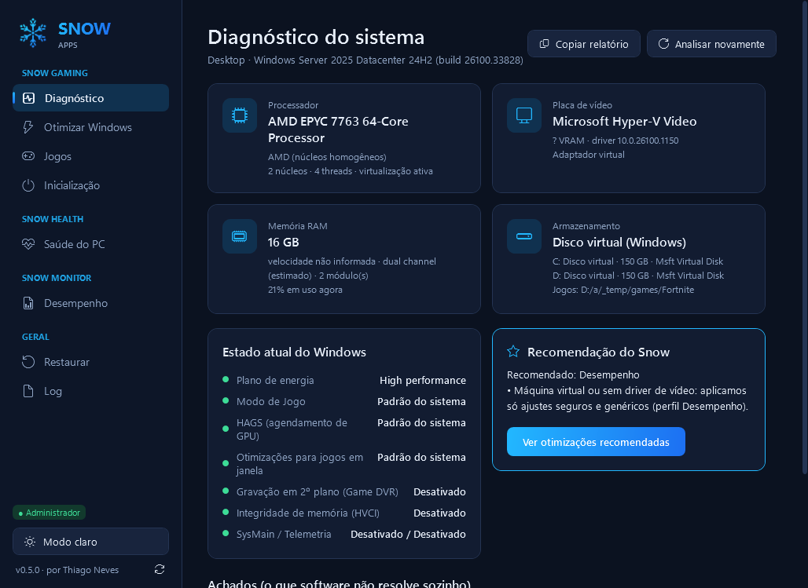
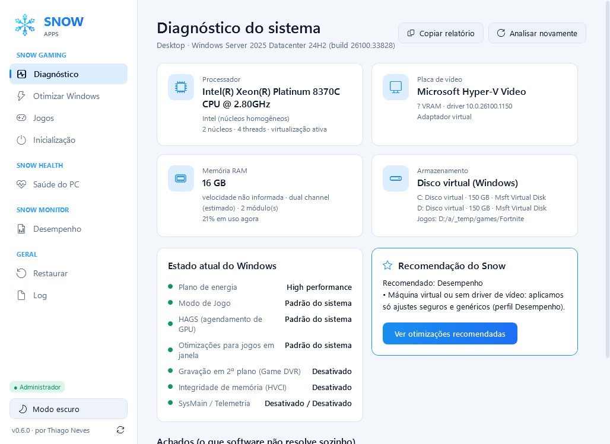
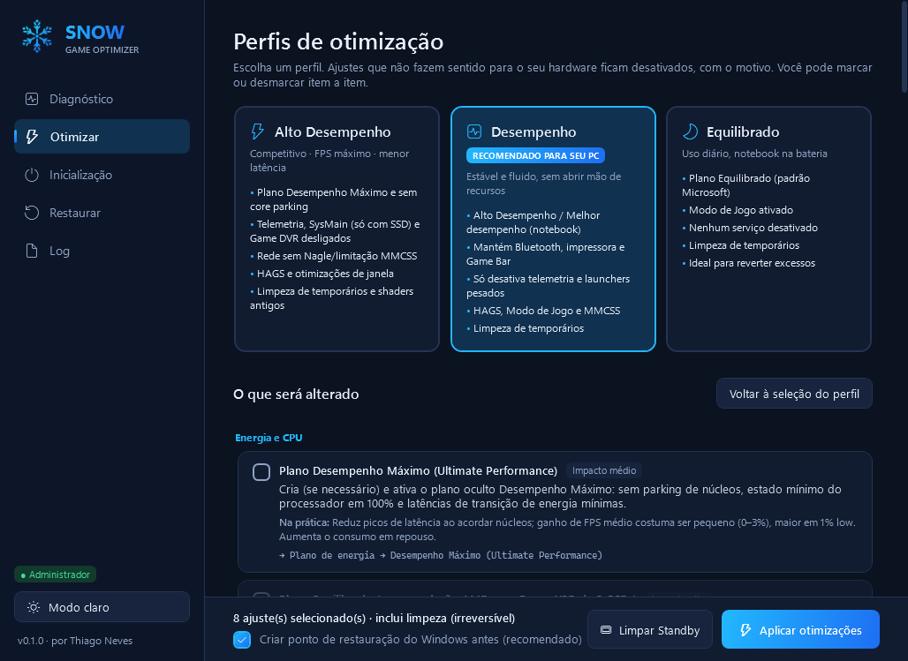
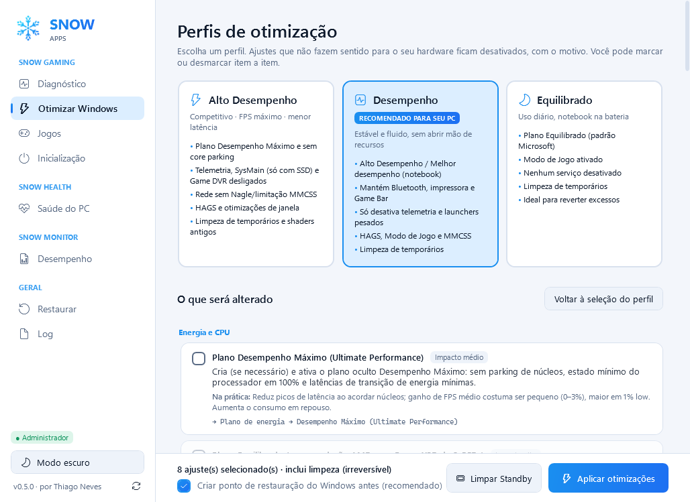
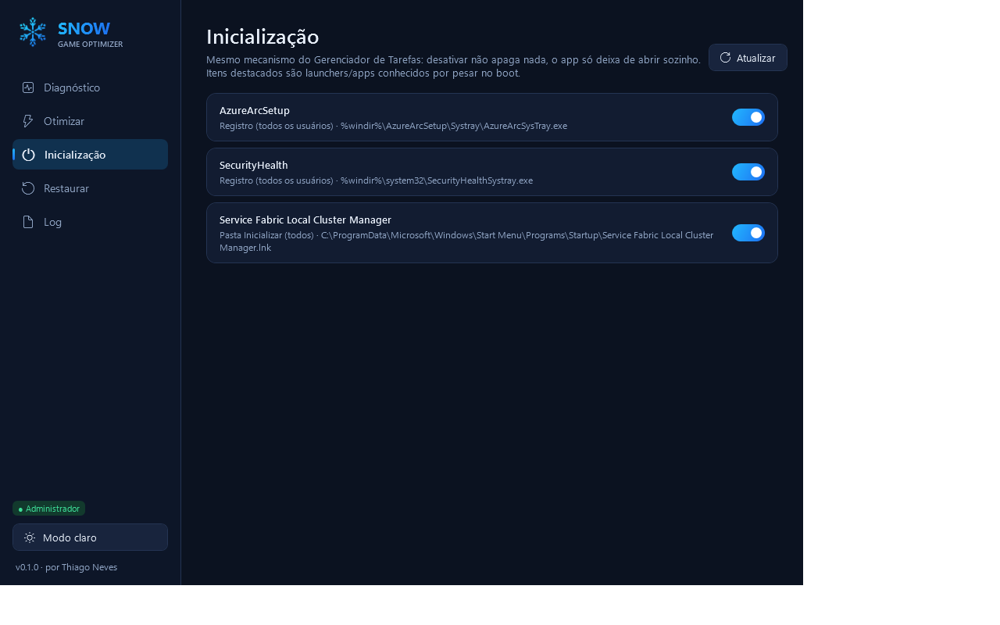
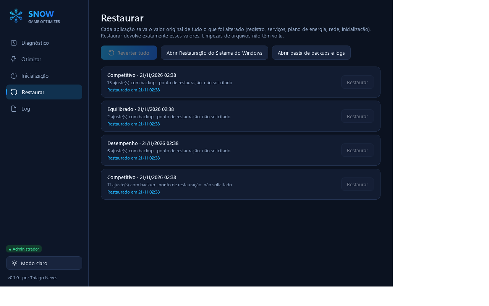

<p align="center">
  
</p>

<p align="center">
  <b>Diagnóstico de hardware e otimizações reais, seguras e reversíveis para jogos no Windows 10 e 11.</b><br>
  C# · .NET 8 · WPF · zero dependências externas · modo escuro
</p>

---

## O que o Snow faz

1. **Diagnostica o PC**: CPU (incluindo Intel híbrida P/E-cores e Ryzen X3D), GPU (VRAM real, driver, suporte a HAGS), RAM (velocidade, canais, tipo), discos (NVMe, SATA SSD ou HDD, onde estão o Windows e os jogos) e o estado do Windows (plano de energia, Modo de Jogo, HAGS, otimizações de janela, Game DVR, HVCI, SysMain e telemetria).
2. **Recomenda um perfil** com base no hardware e explica o porquê.
3. **Mostra exatamente o que será alterado**: cada ajuste lista as chaves de registro, serviços e índices de energia que vai mudar, com uma nota honesta sobre o ganho real.
4. **Aplica com backup**: antes de cada mudança, o valor original é gravado (backup incremental em JSON e, opcionalmente, um ponto de restauração do Windows).
5. **Reverte tudo** com um clique, devolvendo exatamente os valores originais.

## Perfis

| | Alto Desempenho (Competitivo) | Desempenho | Equilibrado |
|---|---|---|---|
| Energia (desktop) | Desempenho Máximo + sem core parking + CPU mín. 100% | Alto Desempenho | Equilibrado |
| Energia (notebook) | Alto Desempenho, ou "Melhor desempenho" com Modern Standby | Modo "Melhor desempenho" (sem fixar clock) | Equilibrado |
| Telemetria (DiagTrack) | desativada | desativada | intacta |
| SysMain | desativado *só se tudo for SSD e houver 16 GB+* | intacto | intacto |
| Game DVR (gravação em 2º plano) | desligado (Game Bar continua) | intacto | intacto |
| Rede | sem Nagle + sem limitação MMCSS | sem limitação MMCSS | intacta |
| HAGS / jogos em janela (Win11) | ativa se a GPU suportar | ativa se a GPU suportar | intactos |
| Modo de Jogo | ativado | ativado | ativado |
| Launchers na inicialização | desativados (reversível) | desativados (reversível) | intactos |
| Limpeza | temporários + shaders antigos (+ Standby se ≤16 GB) | temporários | temporários |

### Regras de hardware (exemplos)
- **Ryzen 9 7900X3D/7950X3D/9950X3D (2 CCDs):** o Snow **não** desativa o core parking, **não** troca o plano Equilibrado e **não** mexe na Game Bar, porque o driver AMD depende deles para manter o jogo no CCD com 3D V-Cache.
- **Notebooks:** nada de CPU travada em 100%; usa o "Modo de energia" do Windows.
- **Modern Standby:** o Windows só permite o plano Equilibrado, então o Snow usa o overlay de energia.
- **HDD ou pouca RAM:** o SysMain é mantido (em HDD ele ajuda muito).
- **HAGS:** só em NVIDIA GTX 10+/RTX, AMD RX 5000+ e Intel Arc, com driver WDDM 2.7+.
- **CPU híbrida no Windows 10:** o diagnóstico avisa que o Thread Director só é usado no Windows 11.

### Honestidade
O Snow não promete "+200 FPS". Cada ajuste traz uma nota "Na prática:" com o efeito real. Exemplo: desativar Nagle só afeta jogos que usam TCP, e esvaziar a lista Standby tem efeito temporário. Coisas que software não resolve (RAM em single channel, XMP/EXPO desligado, jogos em HDD) aparecem como **Achados** no diagnóstico.

## Segurança
- Requer Administrador (o manifesto pede UAC).
- **Nada é apagado** do registro sem backup. Itens de inicialização são desativados como no Gerenciador de Tarefas (chave `StartupApproved`), sem remover a entrada.
- O backup é gravado **antes** de cada ação, com escrita atômica. Se uma ação de um ajuste falhar, as anteriores do mesmo ajuste são desfeitas na hora.
- Recursos de segurança (Defender, HVCI/VBS, firewall, Windows Update) **nunca** são alterados.
- Nenhum processo fica rodando em segundo plano: o Snow só faz algo enquanto está aberto.

Dados: `%ProgramData%\Snow\` (`backups\`, `logs\`, `state.json`).

## Download
Baixe o `.zip` da página [Releases](../../releases) (x64 ou ARM64), extraia e execute **Snow.exe**. Os executáveis são autocontidos: não precisa instalar o .NET.

## Linha de comando
```
snow diagnose [--json]
snow plan     --profile competitivo|desempenho|equilibrado
snow apply    --profile <perfil> [--yes] [--only ids] [--skip ids] [--no-restore-point]
snow restore  [--latest | --id <id> | --all]
snow backups | snow startup | snow purge-standby
snow selftest --profile <perfil>     # aplica → verifica → restaura → confere estado idêntico
```

## Compatibilidade e testes
| Ambiente | Como é testado |
|---|---|
| Windows 11 24H2+ (build 26100) | CI `windows-2025`: build, diagnóstico real, autoteste de ida e volta, aplicar + restaurar, interface renderizada |
| Família Windows 10 (build 20348) | CI `windows-2022`: os mesmos passos |
| Windows 10 1809–22H2 / Windows 11 21H2–23H2 | APIs usadas existem desde o 1709. Recursos específicos são detectados em tempo de execução (HAGS ≥ 19041, jogos em janela ≥ 22000, barra de título escura com fallback para 1809–1909) |
| Qualquer SO | 33 testes de unidade/integração com registro, serviços e energia simulados |

Os runners do GitHub são Windows Server (mesmo kernel do Windows 10/11 desktop, sem GPU física), então o CI valida o código de verdade no Windows. Recursos que dependem de GPU real e Game Bar são cobertos pelos testes com dados simulados.

## Telas (capturas reais geradas pelo CI no Windows)
| Escuro | Claro |
|---|---|
|  |  |
|  |  |
|  |  |

> As capturas vêm de um runner sem GPU física; num PC real, os cartões mostram sua CPU, GPU, RAM e discos.

## Roadmap
- **Próxima versão: otimização por jogo.** Detectar os jogos instalados (Steam/Epic) e, com base no hardware, oferecer predefinições **FPS médio** (qualidade/estabilidade) e **FPS alto** (competitivo) para cada jogo. Isso inclui os arquivos de configuração do jogo, opções de inicialização e ajustes conhecidos da comunidade, sempre com backup e reversão como no restante do app.
- Perfis de driver (NVIDIA/AMD) por jogo.
- Agendamento: reaplicar após grandes atualizações do Windows.

## Compilar
```powershell
dotnet build Snow.sln -c Release
dotnet run --project tests/Snow.Tests
dotnet publish src/Snow.App -c Release -r win-x64 --self-contained -p:PublishSingleFile=true
```

## Arquitetura
```
src/Snow.Core       domínio puro (net8.0): modelos de hardware, catálogo de ajustes, regras e recomendação
src/Snow.Platform   Windows: coleta CIM (1 script PowerShell), P/Invoke (powrprof, kernel32, ntdll),
                    executores com captura/aplicação/verificação/reversão, backup, ponto de restauração
src/Snow.App        WPF (MVVM, temas escuro e claro)
src/Snow.Cli        snow.exe para scripts e CI
tests/Snow.Tests    runner próprio com fakes
```

## Licença
MIT © 2026 Thiago Neves
